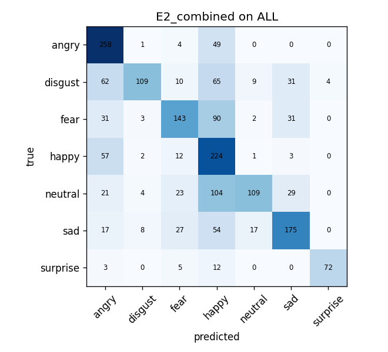
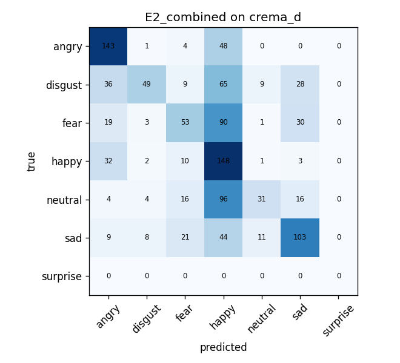
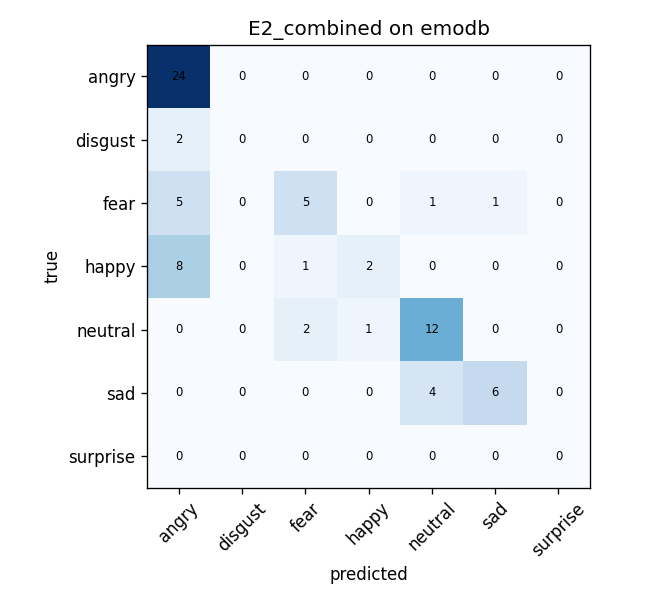
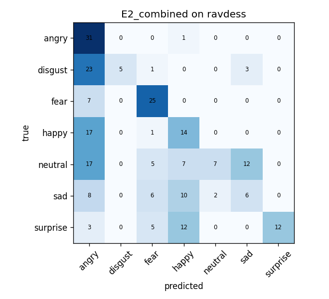
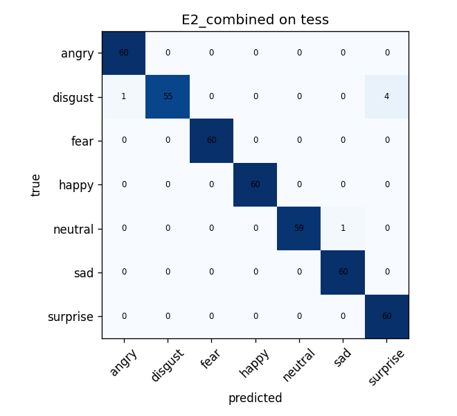
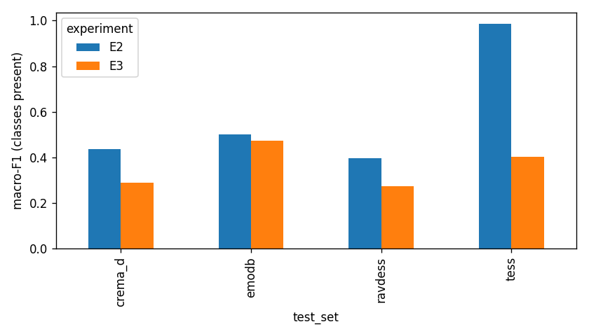
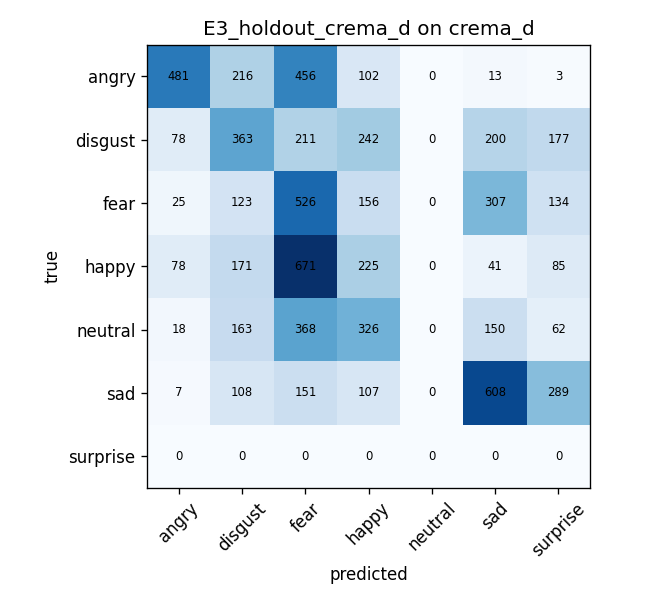
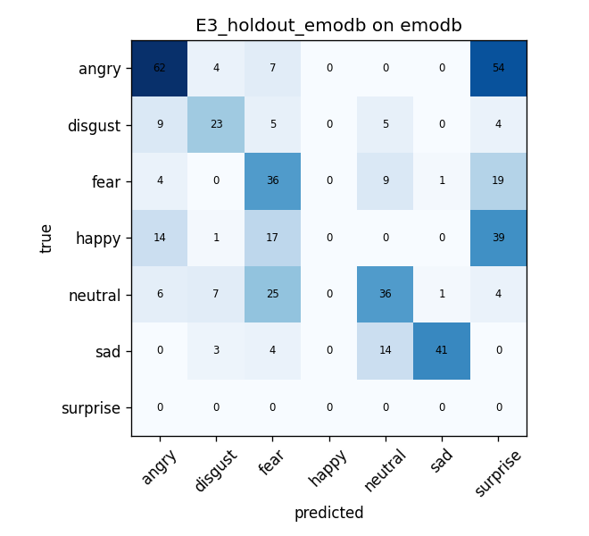
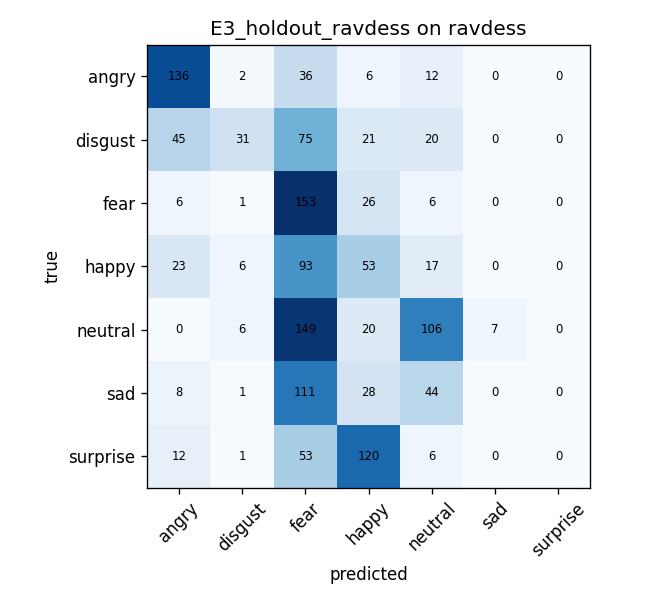
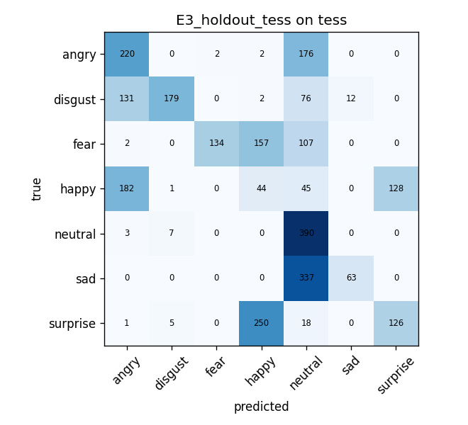

# Speech emotion model: report

Paths are relative to this file (`project/reports/`). Nothing was retrained or tuned for this report. Every number comes from the saved Colab output (copied to `project/results/audio/`). The packaged model is `project/models/audio_best.pt`, the E2 (combined) checkpoint, and `project/code/infer_audio.py` reproduces its Colab test accuracy exactly (section 7).

## 1. Datasets actually used

Source: `project/data/audio_16k/index.csv` (12,135 clips), which is the index inside the Colab upload package and whose test split matches the Colab test sizes (1,881 clips).

**This run used four corpora: RAVDESS, CREMA-D, TESS and EMO-DB. It did NOT include MELD, ESD or SAVEE.** A larger seven-corpus package (`project/data/audio_16k_pcm/`, 23,174 clips) was prepared later, but the results here come from the four-corpus package, so no claim in this report applies to MELD, ESD or SAVEE. EMO-DB is **German** (acted by 10 speakers); RAVDESS, CREMA-D and TESS are North American English.

Clips per dataset and class (whole index):

| Dataset | Clips | angry | disgust | fear | happy | neutral | sad | surprise | Speakers |
|---|---|---|---|---|---|---|---|---|---|
| CREMA-D | 7,441 | 1,271 | 1,271 | 1,271 | 1,271 | 1,087 | 1,270 | 0 | 91 actors |
| TESS | 2,800 | 400 | 400 | 400 | 400 | 400 | 400 | 400 | 2 (OAF, YAF) |
| RAVDESS (speech) | 1,440 | 192 | 192 | 192 | 192 | 288 | 192 | 192 | 24 actors |
| EMO-DB | 454 | 127 | 46 | 69 | 71 | 79 | 62 | 0 | 10 speakers |
| **Total** | **12,135** | | | | | | | | |

Splits (clips): train 8,422, val 1,832 (not shown separately in the table above), test 1,881. Per dataset test sizes: CREMA-D 1,147, TESS 420, RAVDESS 240, EMO-DB 74.

**Label mapping** (classes in the order angry, disgust, fear, happy, neutral, sad, surprise; same as the face model; `models/audio_classes.json` matches the class order stored with the run):
- RAVDESS: vocal channel 01 (speech) only; calm merged into neutral.
- CREMA-D: ANG, DIS, FEA, HAP, NEU, SAD. No surprise exists.
- TESS: surprise = "pleasant surprise" (`ps`).
- EMO-DB: W angry, E disgust, A fear, F happy, T sad, N neutral. Boredom (81 clips) is excluded; there is no surprise.

All clips were converted to 16 kHz mono, silence-trimmed (`librosa.effects.trim`, top_db 30) and centre-cropped to 4 s when longer.

## 2. Split method and the TESS limitation

- **RAVDESS, CREMA-D, EMO-DB: split by speaker.** About 70/15/15 by speaker (seed 42), with at least one speaker per split. EMO-DB is 7/1/2 speakers, so its validation set is one person.
- **TESS: split by word, not by speaker.** TESS has only two speakers, so a speaker split would leave one speaker per split. No word is shared between splits, but **both speakers appear in train, val and test**. TESS results are therefore NOT speaker-independent.
- Small validation sets make model selection noisy (section 5): RAVDESS has 4 validation actors and EMO-DB one.

## 3. Model

Architecture and features are taken from the Colab notebook (`project/colab_upload_audio_v2/audio_colab_train.ipynb`), not from memory:

- Input: 4.0 s at 16 kHz (64,000 samples), first channel, zero-padded.
- Features: `MelSpectrogram(16000, n_fft=512, hop=160, n_mels=64)`, `log(x + 1e-6)`, per-clip mean/std normalisation.
- Network: four blocks of (Conv3x3-BN-ReLU twice, MaxPool) with 32/64/128/256 channels, global average pooling, dropout 0.4, linear to 7. About 1.2M parameters (4.8 MB checkpoint).
- Training: AdamW lr 1e-3, weight decay 1e-2, 2 warmup epochs then cosine, class-weighted cross-entropy with label smoothing 0.1, batch 64, gradient clip 1.0, mixed precision. Augmentation: time roll, gain, noise, SpecAugment (time mask 30, frequency mask 10). Each dataset contributes at most 50% of an epoch. Up to 40 epochs, early stopping on validation macro-F1 with patience 6.
- Seed 42, one run per configuration, Colab T4.

## 4. Results

Macro-F1 is over the classes present in that test set (CREMA-D and EMO-DB have no surprise, so 6 classes; the surprise column is not counted for them).

### 4.1 E2: train on all four corpora, test on each

| Test set | n | Accuracy | Macro-F1 |
|---|---|---|---|
| CREMA-D | 1,147 | 0.459 | 0.438 |
| EMO-DB | 74 | 0.662 | 0.501 |
| RAVDESS | 240 | 0.417 | 0.396 |
| TESS | 420 | **0.986** | **0.986** |
| **ALL (pooled)** | 1,881 | 0.579 | 0.604 |
| Mean of the 4 datasets | | 0.631 | 0.580 |
| Mean without TESS | | 0.513 | 0.445 |

Chance level is 1/7 = 0.143 (1/6 = 0.167 on CREMA-D and EMO-DB). Pooled accuracy is dominated by CREMA-D (61% of test clips) and is lifted by TESS (22%, nearly perfect). The pooled accuracy without TESS is about 0.46 (own calculation from the per-dataset accuracies).

| CREMA-D | EMO-DB |
|---|---|
|  |  |
| **RAVDESS** | **TESS** |
|  |  |

### 4.2 E3: leave-one-dataset-out (the real cross-corpus test)

Train on three corpora, test on every clip of the fourth.

| Held out | n | E3 accuracy | E3 macro-F1 | E2 macro-F1 | Drop | Above chance? |
|---|---|---|---|---|---|---|
| CREMA-D | 7,441 | 0.296 | 0.289 | 0.438 | -0.149 | yes (acc. chance 1/6 = 0.167 for 6 classes) |
| EMO-DB (German) | 454 | 0.436 | 0.472 | 0.501 | -0.029 | yes |
| RAVDESS | 1,440 | 0.333 | 0.273 | 0.396 | -0.123 | yes |
| TESS | 2,800 | 0.413 | 0.404 | 0.986 | **-0.582** | yes |
| **Mean** | | 0.370 | 0.360 | 0.580 | | |

Chance for macro-F1 and accuracy is about 0.143 (7 classes). All four held-out scores are above chance, but only modestly: the model gets roughly one clip in three right on a corpus it has never heard.

| CREMA-D held out | EMO-DB held out |
|---|---|
|  |  |
| **RAVDESS held out** | **TESS held out** |
|  |  |

The EMO-DB drop is small only because the E2 score on its 74-clip, 2-speaker test set was already low and noisy; do not read it as "German transfers well".

## 5. Per-class weaknesses and training instability

**E2 (pooled, 1,881 clips)**

| Class | Precision | Recall | F1 | Note |
|---|---|---|---|---|
| angry | 0.57 | **0.83** | 0.68 | many other classes are mistaken for it |
| disgust | 0.86 | **0.38** | 0.52 | under-detected; goes to angry (62) and happy (65) |
| fear | 0.64 | 0.48 | 0.55 | often predicted as happy (90) |
| happy | **0.37** | 0.75 | 0.50 | the "catch-all": over-predicted (neutral to happy 104, fear to happy 90) |
| neutral | 0.79 | **0.38** | 0.51 | recall poor, spread mostly to happy |
| sad | 0.65 | 0.59 | 0.62 | |
| surprise | 0.95 | 0.78 | 0.86 | exists only in TESS and RAVDESS; RAVDESS surprise F1 is 0.55 |

By dataset, E2 is weakest on **RAVDESS** (sad F1 0.23, neutral 0.25, disgust 0.27) and on **CREMA-D** (neutral 0.28, fear 0.34, disgust 0.37). EMO-DB disgust (n=2 in its test set) and surprise are never predicted correctly; its happy recall is 0.18.

**E3 (held out):** each model collapses onto a "sink" class.
- CREMA-D held out: **neutral is never predicted** (0 of 1,087 found); happy is sent mostly to fear (671 of 1,271).
- RAVDESS held out: **sad and surprise are never predicted** (0 of 192 each); fear absorbs most errors (neutral to fear 149, sad to fear 111); surprise goes to happy (120).
- TESS held out: neutral is the sink (sad to neutral 337 of 400, recall for sad 0.16; neutral recall 0.97 but precision 0.34); happy recall 0.11.
- EMO-DB held out: **happy is never predicted** (0 of 71); the model uses surprise instead (angry to surprise 54, happy to surprise 39), which does not exist in EMO-DB.
- Happy is poor in E3 on every corpus (F1 0.00 to 0.23).

**Training instability.** Validation macro-F1 swings from epoch to epoch (`results/audio/*/history.csv`):

| Run | Epochs | Best val F1 (epoch) | Lowest | Mean absolute change per epoch | Largest jump | Last epoch |
|---|---|---|---|---|---|---|
| E2 combined | 17 | 0.633 (10) | 0.076 | 0.12 | 0.41 | 0.547 |
| E3 CREMA-D held out | 8 | 0.588 (**1**) | 0.202 | 0.22 | 0.34 | 0.327 |
| E3 EMO-DB held out | 11 | 0.618 (4) | 0.047 | 0.18 | 0.40 | 0.548 |
| E3 RAVDESS held out | 18 | 0.689 (11) | 0.190 | 0.10 | 0.33 | 0.562 |
| E3 TESS held out | 15 | 0.442 (8) | 0.073 | 0.08 | 0.16 | 0.318 |

E2 dropped to 0.076 at epoch 2 and recovered to 0.48 by epoch 3. The E3 CREMA-D model's "best" checkpoint is from **epoch 1**, and its validation F1 never recovered, so that held-out result comes from an almost untrained model. Because the checkpoint is picked as the maximum of a very noisy curve (with small validation sets of a few speakers), the reported test scores carry extra selection noise; a different seed could easily move them by several points. The cause of the swings (high learning rate with BatchNorm, small validation sets, class-weighted resampling) was not tested.

## 6. Discussion

**E2 is optimistic.** All four corpora are acted, recorded in controlled conditions, and the training and test clips of a corpus share recording conditions, scripts and microphones. TESS has only two speakers, appears in every split, and scores 0.99, which says the model can separate two speakers' acted emotions on shared words, not that it generalises. Without TESS the mean E2 macro-F1 is 0.445 and pooled accuracy about 0.46. The EMO-DB E2 test is 74 clips from two speakers, so its numbers are very noisy.

**E3 is the real cross-corpus ability, and it is limited.** Held out, the model reaches 0.27 to 0.47 macro-F1 (mean 0.36) against 0.14 for chance. It transfers the high-arousal classes (angry) better than the quiet ones (neutral, sad) and the model tends to fall into one wrong class per corpus rather than spreading its errors. TESS drops from 0.986 to 0.404 when the corpus is truly unseen, which is the clearest sign of how much of E2 was corpus familiarity.

**What the numbers do not tell us.** All data is acted. Nothing here shows how the model performs on spontaneous speech, other languages, noisy microphones or a browser recording; MELD (spontaneous TV dialogue), ESD and SAVEE were not part of this run. One seed per run, no confidence intervals, and noisy checkpoint selection mean differences of a few points are not meaningful. The test splits were not used for tuning anything here.

**Comparison with the face model:** its leave-one-out mean macro-F1 is 0.34 (fer2013 held out: 0.09, below chance). The speech model's 0.36 is similar and, unlike the face model, nowhere falls below chance, but it is also far from reliable.

## 7. Packaging and check

- `project/models/audio_best.pt` is `E2_combined/best.pt` (same bytes as the Colab `best_model.pt`); `project/models/audio_classes.json` is the class order from the run (angry, disgust, fear, happy, neutral, sad, surprise; it matches the expected order).
- `project/code/infer_audio.py` rebuilds the architecture and preprocessing exactly as in the notebook. `predict_audio(path_or_array, sr)` returns `label`, `confidence`, `probs`. Raw input (an upload or recording) is also silence-trimmed and centre-cropped to 4 s, as the training data was; clips already in `data/audio_16k` are not re-trimmed.
- Check: running all 1,881 test clips gives accuracy **0.5795**, identical to Colab (E2 ALL 0.5795). The 20-clip sample (seed 42) gave 0.70, which is a small-sample figure and not an accuracy estimate.
- Web app: `POST /predict/audio` in the model service, proxied by Express; see `app/README.md`. The app shows the "uncertain" label when the top probability is under 0.5.

## 8. Limitations

1. Acted speech only; no spontaneous speech, no MELD, ESD or SAVEE in this run.
2. TESS is split by word with two speakers present in every split, so it is not speaker-independent and inflates E2.
3. EMO-DB is German and has a 74-clip, 2-speaker E2 test set; boredom was excluded; no surprise class.
4. CREMA-D has no surprise class, so its macro-F1 covers 6 classes.
5. Unstable training; checkpoints chosen on very noisy validation F1 (E3 CREMA-D from epoch 1).
6. Single seed, no confidence intervals.
7. Uploaded or recorded audio in the web app has never been evaluated; browser recordings differ from the training data (microphone, noise, language, speaking style).

## 9. Files

- Model: `project/models/audio_best.pt`, `project/models/audio_classes.json`
- Code: `project/code/infer_audio.py`; app: `app/model_service/audio_service.py`, `app/client/src/components/AudioTab.jsx`
- Results: `project/results/audio/` (`summary.csv`, `E2_combined.json`, `E3_holdout_*.json`, histories, confusion matrices)
- Raw Colab output: `project/colab_results_audio_ingest/` (from `colab_results-20261012T155842Z-1-001.zip`)
- Decisions: `project/DECISIONS.md`
