# Facial emotion model: report

Image paths are relative to this file (`project/reports/`). Nothing was retrained or tuned for this report: every number comes from the saved Colab output (`project/results/`, raw copy in `project/collab_results/`). The previous version is kept as `FACE_MODEL_REPORT_prev.md`.

## 1. Datasets, label mapping, split

All four datasets are mapped to the same 7 classes, in this order: angry, disgust, fear, happy, neutral, sad, surprise.

| Dataset | Content | Rows used | Label source | Notes |
|---|---|---|---|---|
| FER-2013 | 48x48 greyscale web faces, spontaneous | 33,500 | FER+ 10-annotator majority vote | 2,387 rows dropped (tie, unknown, NF, contempt, or ambiguous duplicate pixels). Only in-the-wild source |
| JAFFE | 213 stills, 10 posed Japanese female subjects | 213 | file-name code (AN, DI, FE, HA, NE, SA, SU) | about 30 images per class |
| RAVDESS (speech video) | 2,880 clips, 24 actors, acted | 14,400 | filename emotion code; calm merged into neutral | 5 face frames per clip |
| CREMA-D (video) | 7,441 clips used, 91 actors, acted | 37,205 | filename code (ANG, DIS, FEA, HAP, NEU, SAD) | **no surprise class**; scored on 6 classes |

Face frames for the video datasets and JAFFE: MediaPipe face detection, square crop with 20% margin, 224x224. FER-2013 is used as is.

**Split method (leakage control).**
- JAFFE, RAVDESS, CREMA-D are split **by subject** (about 70/15/15, seed 42; RAVDESS 16/4/4 actors, CREMA-D 63/14/14, JAFFE 6/2/2). All frames of a person stay in one split. The script asserts that no subject appears in two splits.
- FER-2013 has no subject IDs. Its official `train/` gives train plus a 10% val; its official `test/` is the test set (6,722 rows). Identity leakage between its folders cannot be ruled out.
- Class-weighted loss from the combined train split.

**Experiments.**
- **E2:** train on the train splits of all four datasets, test on each dataset's test split.
- **E3:** leave one dataset out entirely (train on three, test on all of the fourth). CNN only.
- E1 (single-dataset training) was not run.

## 2. Models

| | CNN (`SmallCNN`) | ResNet-18 |
|---|---|---|
| Input | 48x48 greyscale | 224x224 RGB, ImageNet normalisation |
| Size | 4.69M parameters, 18 MB checkpoint | ImageNet-pretrained, 45 MB checkpoint |
| Training | AdamW, cosine, label smoothing 0.1, augmentation (flip, rotation, jitter, random erasing) | same, head for 3 epochs then full fine-tune |
| E2 run | 25 epochs, best epoch 19 | 14 epochs, best epoch 8 |
| Epoch time (T4) | about 80 s | about 240 s |

Both trained on a Colab Tesla T4, one seed (42), early stopping on validation macro-F1.

## 3. Results

Macro-F1 first, accuracy in brackets. CREMA-D is scored over its 6 classes.

### 3.1 E2: both models, per dataset

| Dataset | Test n | CNN | ResNet-18 |
|---|---|---|---|
| FER-2013 | 6,722 | 0.710 (0.810) | **0.746** (0.827) |
| JAFFE | 44 | **0.632** (0.659) | 0.404 (0.432) |
| RAVDESS | 2,400 | 0.573 (0.570) | **0.649** (0.662) |
| CREMA-D | 5,710 | 0.543 (0.542) | 0.542 (0.538) |
| **Mean of 4** | | **0.614** (0.645) | 0.585 (0.615) |
| Mean of the 3 large (no JAFFE) | | 0.609 | 0.646 |

### 3.2 E3: leave-one-dataset-out (CNN)

Chance level is 1/7 = **0.143** (1/6 = 0.167 for CREMA-D, which has 6 classes).

| Held out | n | In-dataset E2 macro-F1 | E3 macro-F1 | E3 accuracy | vs chance (acc. 0.143) |
|---|---|---|---|---|---|
| FER-2013 | 33,500 | 0.710 | **0.088** | 0.072 | **below chance** |
| JAFFE | 213 | 0.632 | 0.454 | 0.484 | above |
| RAVDESS | 14,400 | 0.573 | 0.412 | 0.468 | above |
| CREMA-D | 37,205 | 0.543 | 0.416 | 0.420 | above (1/6 = 0.167) |
| **Mean** | | 0.614 | **0.342** | 0.361 | |

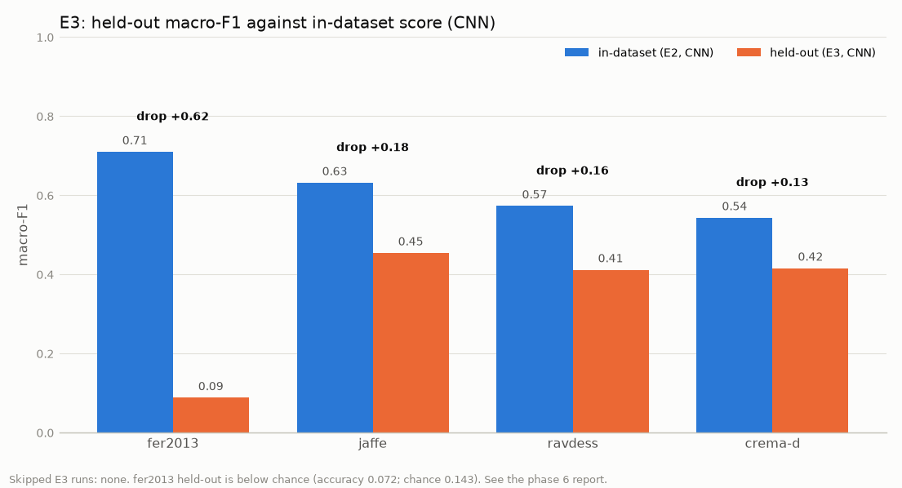

The three acted datasets lose 0.13 to 0.18 macro-F1 when held out. FER-2013 loses 0.62.

## 4. Per-class findings

### E2 (all four datasets in training)

| Dataset | Strong | Weak |
|---|---|---|
| FER-2013 | happy 0.91, surprise 0.85, neutral 0.82, angry 0.76 | **disgust 0.43** (n=53, recall 0.38), fear 0.55 (n=165; 55 of them predicted surprise), sad 0.65 (neutral confused with sad, 313 rows) |
| JAFFE (6 to 7 per class) | fear 7/7, disgust 6/6, happy 5/7 | **angry 1/6** (5 go to disgust), surprise 3/6, sad 3/6 |
| RAVDESS | disgust 284/320, happy 265/320 | **fear 105/320** (96 to surprise, 84 to sad), neutral 193/480, sad 169/320 (65 to disgust) |
| CREMA-D | happy 770/975 | **sad 352/975** (350 to fear), neutral 354/835, angry 434/975; disgust and angry often read as fear |

ResNet-18 differs mainly on JAFFE: it sends 5 of 6 surprise and 4 of 6 neutral images to fear and gets happy 1/7, which is why its JAFFE score is low. On FER-2013 it is slightly better on every class. On RAVDESS it recovers angry (0.89 recall vs 0.60) and fear (0.50 vs 0.33).

### E3 (held-out dataset never seen)

- **FER-2013 held out:** a collapse onto one class. **60% of all predictions are "disgust"**. Disgust recall is 0.85 but precision 0.01, so the class looks "found" only because everything lands in it. Neutral recall is 1.3% (148 of 11,773), happy 9% (829 of 9,199). Neutral to disgust alone is 7,113 rows, happy to disgust 5,264, sad to disgust 2,927. Surprise also leaks into fear (1,065).
- **JAFFE held out:** **angry recall 1/30** (22 are read as neutral); disgust recall 6/29 (17 go to sad); fear 13/32 (14 go to sad). Happy (25/31) and surprise (22/30) transfer well. Disgust and fear are both pulled towards sad, angry towards neutral.
- **RAVDESS held out:** disgust (1,748/1,920) and happy transfer; angry goes to neutral (733) and disgust (378); fear is poor (368/1,920, spread over disgust, neutral and sad); surprise is almost never found (51/1,920).
- **CREMA-D held out:** happy and disgust transfer; the low-arousal classes collapse into neutral (sad to neutral 2,258, angry to neutral 1,856, fear to neutral 1,589). Surprise does not exist in CREMA-D, yet 2,680 rows are predicted surprise.

### Training curves (from `history.csv`)

- E2 CNN: validation macro-F1 peaked at epoch 19 (0.611); at the last epoch train accuracy was 0.89 against validation accuracy 0.61. ResNet-18: peak at epoch 8 (0.657), train accuracy 0.93 vs validation 0.65 at the end. Both models fit the training data much better than the held-out subjects, which is moderate overfitting; early stopping limited it.
- E3 FER-2013 held out: validation macro-F1 on the three training datasets reached 0.51, but the test score on FER-2013 was 0.088. Validation never warned of the transfer failure, because validation comes from the same datasets as training.

## 5. Confusion matrices

Rows are the true class, columns the prediction.

### E2, CNN
| FER-2013 | JAFFE |
|---|---|
| 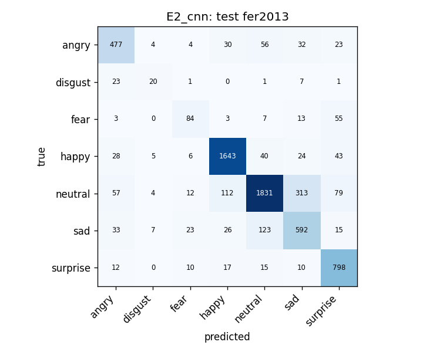 | 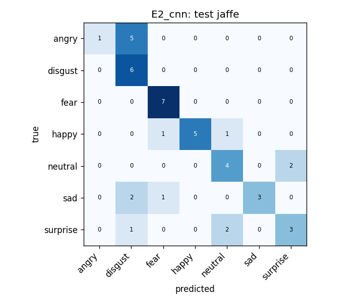 |
| **RAVDESS** | **CREMA-D** |
| 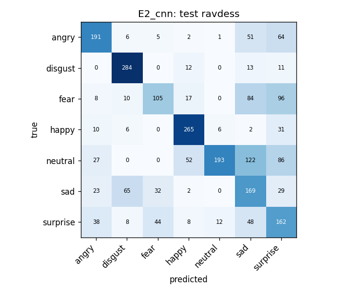 | 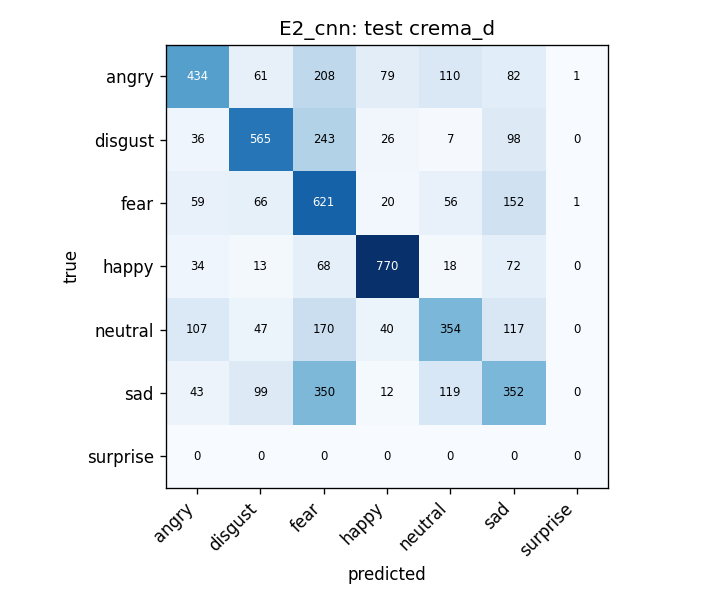 |

### E2, ResNet-18
| FER-2013 | JAFFE |
|---|---|
| 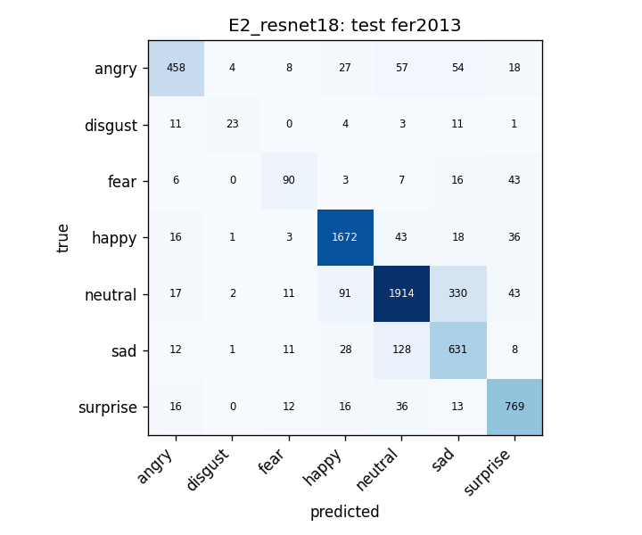 | 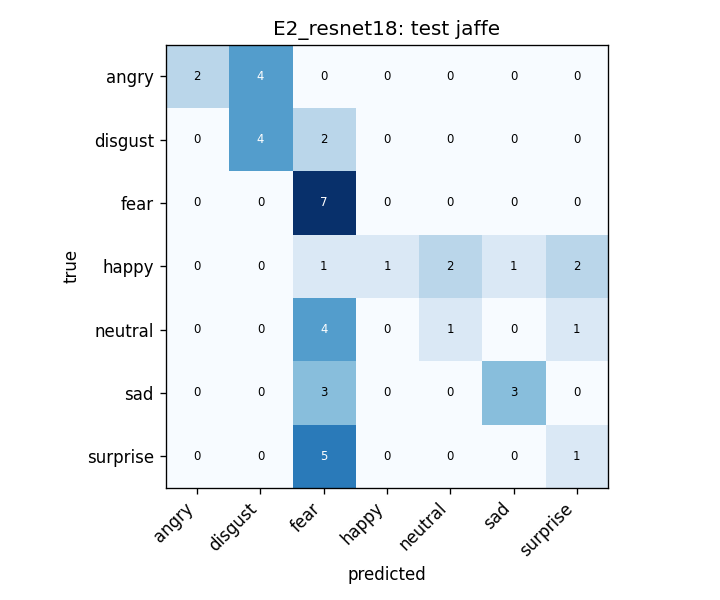 |
| **RAVDESS** | **CREMA-D** |
| 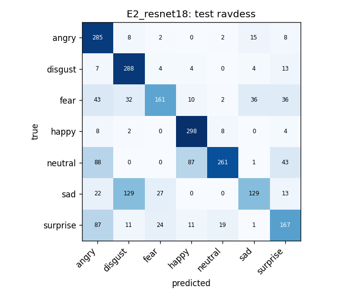 | 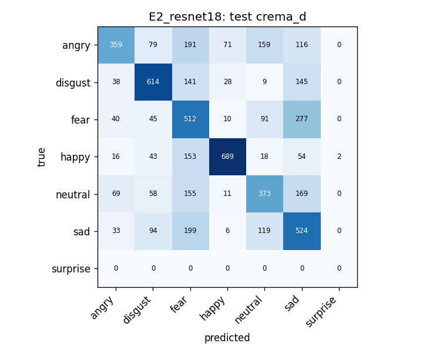 |

### E3, CNN, held-out dataset
| FER-2013 held out | JAFFE held out |
|---|---|
| 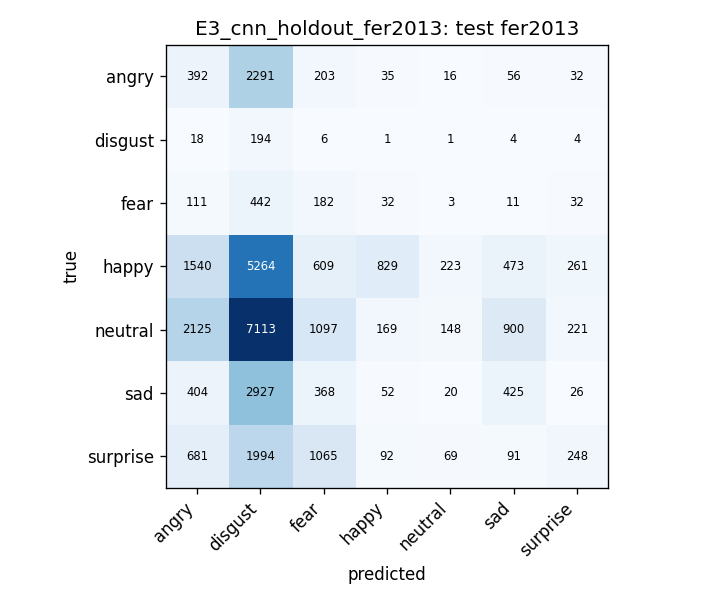 | 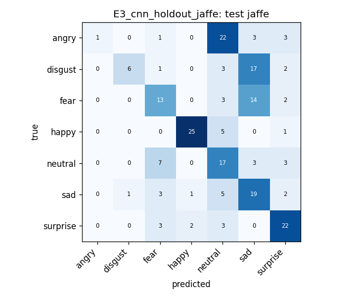 |
| **RAVDESS held out** | **CREMA-D held out** |
| 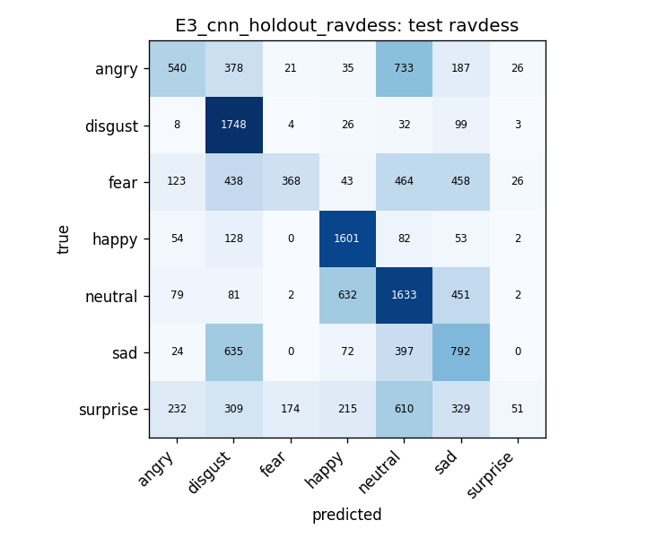 | 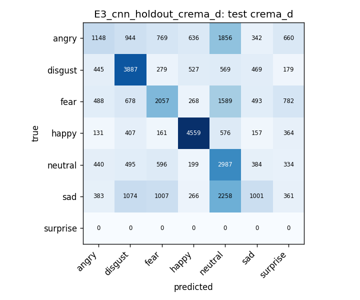 |

## 6. Model choice

**The packaged and deployed model is the CNN.** The web app and `project/code/infer.py` use it, and it is small (18 MB, 4.7M parameters) and about 3 times faster to train, which also makes it cheap at inference on a laptop.

The numbers do **not** show that the CNN is more accurate:
- The notebook's rule (higher mean E2 macro-F1) picked the CNN, 0.614 against 0.585. That lead comes from **JAFFE alone (44 test images, 6 to 7 per class)**: the CNN gets 0.632 there and ResNet-18 0.404, a gap of 0.23 that rests on a handful of images.
- On the **three large datasets the gap is small and points the other way**: CNN 0.609, ResNet-18 0.646 (FER-2013 +0.036, RAVDESS +0.077, CREMA-D 0.001, all in ResNet-18's favour or a tie). With one seed per model and no confidence intervals we cannot tell this from noise, so we do not claim either model is better on those datasets.
- The winner was chosen on **test** scores. The validation macro-F1 favours ResNet-18 (0.657 against 0.611).
- E3 was run for the CNN only, so there is no ResNet-18 transfer result to compare.

The CNN is kept for practical reasons (size, speed, already integrated), not because it beat ResNet-18.

## 7. Limitations

1. **Held-out FER-2013 is below chance** (0.088 macro-F1, 0.072 accuracy, chance 0.143). The model was trained only on posed lab faces and acted-video frames (JAFFE, RAVDESS, CREMA-D); these do not transfer to in-the-wild faces. The model sends 60% of FER-2013 rows to "disgust". The domain gap is the most likely reason, with the 48 px resolution as a possible contributor, but neither was tested.
2. **JAFFE has only 44 test images** in E2 (6 to 7 per class; one image moves a class recall by 14 to 17 points) and 213 in E3. Its scores, including the CNN's lead, are very noisy.
3. **Pooled E2 accuracy is dominated by FER-2013.** FER-2013 is 45% of the combined test rows (6,722 of 14,876), so accuracy over all rows (about 0.67 for the CNN) is mostly a FER-2013 number. The per-dataset table and the mean of datasets are the fairer summary.
4. **E2 is in-distribution, E3 is not.** E2 scores say how well the model works on faces like its training data. E3 is the better guide to behaviour on a new source, and it is much lower (mean 0.342). Expect the live camera to look more like FER-2013 or worse than like E2.
5. **Frames are not independent.** Five frames per clip are highly correlated, and RAVDESS modality 01 and 02 share a performance, so the effective sample size is below the row counts. FER-2013 identities may cross its train and test folders.
6. **Acted data and class issues.** Three of four sources are posed or acted. Disgust is rare in FER-2013 (53 test rows). CREMA-D has no surprise class. RAVDESS calm is merged into neutral. FER+ labels are noisy.
7. **Single seed, no confidence intervals.** Differences of a few points are not established.
8. **Not done:** real E1, ResNet-18 E3, a second seed, calibration, a face-detector accuracy check.

## 8. Discussion in plain English

When the model has seen a dataset's style during training, it does reasonably well: about 0.61 macro-F1 on average. It reads happy and surprise faces well and struggles with fear, sad and disgust. Subtle emotions look like each other: sad gets mistaken for neutral or fear, anger for neutral or disgust.

The more important finding is what happens on a source it has never seen. On the acted datasets it loses roughly a quarter of its score. On FER-2013, the only real-world set, it fails badly: it labels most faces "disgust" and is worse than random guessing. The training data lacks ordinary, spontaneous faces, so the model learns what *acted* emotion looks like and treats ordinary expressions as unfamiliar. For the same reason, the strong E2 FER-2013 score (0.71) shows the model can learn FER-2013 when it is in training, but not that it generalises to other real-world faces.

The CNN and ResNet-18 are about equally good on the large datasets. The CNN looks better overall only because of 44 JAFFE images. We keep the CNN because it is small and fast and already runs in the app. Anyone relying on its output in the real world should treat the "uncertain" label and low-confidence predictions as the normal case for faces unlike the training data.

## 9. Files

- Model: `project/models/face_emotion_best.pt`, `project/models/model_card.md`
- Results: `project/results/` (metrics, histories, confusion matrices, `E3_summary.csv`, `E3_error_pairs.csv`)
- Raw Colab output: `project/collab_results/` (zip and notebook), `project/colab_results/`
- Splits: `project/data/splits.csv`, `project/data/experiments.json`
- Decisions log: `project/DECISIONS.md`
